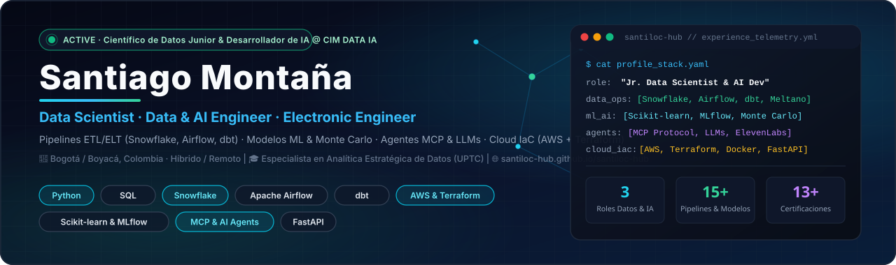

  
   

  <!--CV_STATUS:start-->
  <!-- status: Building Data Pipelines, ML Models & Autonomous AI Agents @ CIM DATA IA | updated: 2026-10-21 20:06 UTC -->
  

    
    
    
    
    
  

  <!--CV_STATUS:end-->

---

## 👋 Perfil Profesional / Executive Summary

**🇨🇴 Español:** Científico de Datos e Ingeniero de Datos e IA con formación en Ingeniería Electrónica y Especialización en Analítica Estratégica de Datos (UPTC). Experiencia demostrada en el diseño y orquestación de pipelines ETL/ELT (Snowflake, Apache Airflow, dbt, Meltano), creación de modelos predictivos y algoritmos de clasificación (Random Forest, XGBoost, simulaciones cuantitativas Monte Carlo, tracking con MLflow), soluciones de IA conversacional (LLMs, agentes autónomos, integración de MCPs y asistentes de voz con ElevenLabs) y despliegue de infraestructura cloud en AWS mediante Terraform (IaC), Docker y FastAPI bajo flujos CI/CD.

**🇬🇧 English:** Data Scientist and Data & AI Engineer with a background in Electronic Engineering and a Specialization in Strategic Data Analytics (UPTC). Experienced in end-to-end data pipeline engineering (Snowflake, Apache Airflow, dbt, Meltano), predictive modeling and classification algorithms (Random Forest, XGBoost, Monte Carlo quantitative simulations, MLflow), conversational AI solutions (LLMs, autonomous agents, Model Context Protocol - MCP, ElevenLabs voice AI), and cloud infrastructure provisioning on AWS using Terraform (IaC), Docker, and FastAPI under CI/CD.

> 💡 **¿Quieres explorar mi trayectoria de forma interactiva?** Visita mi **[Portal Web de Experiencia (https://santiloc-hub.github.io/santiloc-hub/)](https://santiloc-hub.github.io/santiloc-hub/)** con filtros dinámicos por tecnología, línea de tiempo interactiva y selector de idioma ES/EN.

---

## 💼 Trayectoria Profesional (Auto-Sincronizada)

### 🟢 **ACTUAL** Científico de Datos Junior & Desarrollador de IA — **CIM DATA IA — Consultoría de Datos e Inteligencia Artificial**
📅 *Ene 2026 – Actualidad* &nbsp;|&nbsp; 📍 *Boyacá / Remoto, Colombia*

  - Desarrollo de modelos predictivos y algoritmos de clasificación en Python (scikit-learn, Random Forest, XGBoost) para pronóstico y priorización operativa, con seguimiento en MLflow.
  - Implementación de soluciones de IA conversacional y agentes autónomos integrando MCPs (Model Context Protocol) para interacciones avanzadas y despliegue automatizado de infraestructura empresarial.
  - Colaboración activa en el aprovisionamiento y despliegue de infraestructura en la nube (AWS EC2, S3, IAM) mediante Terraform (IaC), asegurando entornos reproducibles y escalables.
  - Ejecución de simulaciones cuantitativas (Monte Carlo) y pruebas de estrés para comprobar la eficacia del diseño de datos, orquestando pipelines ETL/ELT con Python, SQL, Snowflake, dbt y Apache Airflow bajo CI/CD.

**Stack & Dominio:** `Python` · `SQL` · `AWS` · `Terraform (IaC)` · `Snowflake` · `Apache Airflow` · `dbt` · `MCP (Model Context Protocol)` · `Autonomous Agents` · `Monte Carlo` · `FastAPI` · `MLflow`

---

### 🔹 Asistente de Desarrollo (Datos e IA) — **CIM DATA IA**
📅 *May 2025 – Dic 2025* &nbsp;|&nbsp; 📍 *Boyacá, Colombia*

  - Optimización analítica y ajuste de chatbots y modelos de IA conversacional bancarios, mejorando de forma medible la precisión de clasificación y respuesta a clientes.
  - Colaboración en el desarrollo de un asistente de voz con IA para verificación automatizada de préstamos en el sector financiero usando Python, ElevenLabs y APIs de terceros.
  - Implementación de automatizaciones de procesos operativos y estandarización de entornos de experimentación mediante Anaconda y virtualenv, garantizando portabilidad.

**Stack & Dominio:** `Python` · `ElevenLabs Voice AI` · `LLMs & NLP` · `Banking Chatbots` · `REST APIs` · `Anaconda & virtualenv` · `SQL`

---

### 🔹 Practicante de Datos y Automatización de Operaciones — **HOLCIM S.A. — Operaciones Industriales y Planta**
📅 *May 2024 – Nov 2024* &nbsp;|&nbsp; 📍 *Nobsa, Boyacá, Colombia*

  - Automatización de la recolección, depuración y procesamiento de datos operativos en planta industrial mediante scripts en Python y Google Apps Script.
  - Diseño e implementación de una base de datos centralizada para mejorar la trazabilidad, confiabilidad y organización de activos industriales.
  - Creación de tableros interactivos de KPIs en Looker Studio para el monitoreo en tiempo real de productividad y disponibilidad de equipos.

**Stack & Dominio:** `Python` · `Google Apps Script` · `Looker Studio` · `Industrial Data` · `SQL / Databases` · `KPI Dashboards`

---

## 🛠️ Matriz de Habilidades Técnicas

| Dominio | Tecnologías & Herramientas |
| :--- | :--- |
| **Ingeniería de Datos y Orquestación** | `Snowflake (Cloud Data Warehouse)` · `Apache Airflow (DAG Orchestration)` · `dbt (SQL Transformations)` · `Meltano (ELT Extraction)` · `Pipelines ETL / ELT` · `Modelamiento de Datos & Calidad` |
| **Ciencia de Datos y Machine Learning** | `Scikit-learn (Random Forest, XGBoost, Ensembles)` · `Simulaciones Cuantitativas (Monte Carlo)` · `MLflow (Experiment Tracking & MLOps)` · `TensorFlow & PyTorch` · `Análisis Estadístico & Validación de Hipótesis` · `Modelado Predictivo & Clasificación` |
| **IA Conversacional y Agentes MCP** | `Model Context Protocol (MCP) Integration` · `Agentes Autónomos de IA` · `LLMs (Claude, OpenAI, Prompt Engineering)` · `ElevenLabs (Asistentes de Voz con IA)` · `Optimización de Chatbots Bancarios & NLP` |
| **Cloud, DevOps e IaC** | `Terraform (Infrastructure as Code - IaC)` · `AWS (EC2, S3, IAM)` · `FastAPI & Pydantic (APIs REST en Producción)` · `Docker & Entornos Reproducibles (Anaconda, virtualenv)` · `CI/CD con GitHub Actions & Git` |
| **Lenguajes de Programación** | `Python (pandas, NumPy, SciPy, scikit-learn, Matplotlib)` · `SQL (Consultas Analíticas, CTEs, Optimización)` · `R (Estadística & Visualización)` · `JavaScript / TypeScript (ES6+)` · `C++` |
| **Bases de Datos y Data Warehouse** | `Snowflake` · `PostgreSQL` · `MySQL` · `SQLite` |
| **Visualización y BI** | `Looker Studio` · `Power BI` · `Tableau` · `Storytelling con Datos & KPIs Operativos` |

---

## 🚀 Proyectos Destacados de Ingeniería, Datos e IA

| Proyecto | Descripción | Stack |
| :--- | :--- | :--- |
| **[🔗 Agente Autónomo de Noticias e IA (news_agent)](https://github.com/santiloc-hub/news_agent)** *AI Agents & LLMs* | Pipeline autónomo con IA que integra modelos de lenguaje y flujos estructurados para investigación, síntesis y generación automatizada de contenido informativo. | `Python`, `LLMs`, `MCP`, `Autonomous Agents`, `Automation` |
| **[🔗 API y Despliegue de Clasificación de Vehículos](https://github.com/santiloc-hub/car-classification-deployment)** *MLOps & FastAPI* | Modelo multiclase serializado y desplegado en producción con validación Pydantic, logging, pruebas automáticas e interfaz interactiva para inferencia de punta a punta. | `Python`, `scikit-learn`, `FastAPI`, `Flask`, `Streamlit`, `Pydantic` |
| **[🔗 Predicción de TRM Dólar y Cripto con Sentimiento & Monte Carlo](https://github.com/santiloc-hub/Proyecto_TRM_Dolar)** *Data Science & Quantitative Simulation* | Modelado predictivo que combina series históricas, análisis de sentimiento de noticias actuales y simulaciones de Monte Carlo para estimar escenarios de mercado. | `Python`, `Scikit-learn`, `Monte Carlo`, `NLP Sentiment`, `Jupyter Notebook` |
| **[🔗 Asistente Conversacional de Voz con IA (ElevenLabs)](https://github.com/santiloc-hub/eleven_labs_agent_test)** *Conversational AI* | Agente interactivo de voz construido con Python y ElevenLabs para flujos conversacionales automatizados de baja latencia y verificación de datos. | `Python`, `ElevenLabs`, `LLMs`, `Voice AI`, `REST APIs` |
| **[🔗 Analítica de Cadena de Abastos y Marketplace](https://github.com/santiloc-hub/coomproriente-marketplace-analytics)** *Data Analytics & Operations* | Modelado analítico de transportistas, comerciantes y dinámica de precios para optimización de operaciones y cadena de abastecimiento. | `Python`, `pandas`, `SQL`, `Data Visualization`, `Operations Analytics` |
| **[🔗 Modelos Predictivos de Churn y Pronóstico Deportivo](https://github.com/santiloc-hub/Churn_Prediction)** *Machine Learning* | Ensambles de clasificación (Decision Trees, Random Forest) e ingeniería de características para retención de clientes y pronóstico probabilístico. | `Python`, `scikit-learn`, `pandas`, `Matplotlib`, `Classification` |

---

## ⚡ Repositorios y Actividad Reciente en GitHub

| Repositorio | Descripción | Lenguaje | Última actualización |
| :--- | :--- | :--- | :--- |
| **[`matrimonio-mechis`](https://github.com/santiloc-hub/matrimonio-mechis)** | Repositorio de ingeniería, analítica de datos e IA. | `HTML` | `2026-10-09` |
| **[`itera-web`](https://github.com/santiloc-hub/itera-web)** | Repositorio de ingeniería, analítica de datos e IA. | `HTML` | `2026-10-06` |
| **[`Bot_Minecraft`](https://github.com/santiloc-hub/Bot_Minecraft)** | Repositorio de ingeniería, analítica de datos e IA. | `Python` | `2026-07-18` |
| **[`-sports-betting-bot`](https://github.com/santiloc-hub/-sports-betting-bot)** | Repositorio de ingeniería, analítica de datos e IA. | `Go` | `2026-05-29` |
| **[`Repaso_ML`](https://github.com/santiloc-hub/Repaso_ML)** | Repositorio de ingeniería, analítica de datos e IA. | `Jupyter Notebook` | `2025-10-29` |
| **[`eleven_labs_agent_test`](https://github.com/santiloc-hub/eleven_labs_agent_test)** | Repositorio de ingeniería, analítica de datos e IA. | `Python` | `2025-08-19` |

---

## 🎓 Educación & Certificaciones Verificables

### Formación Académica
- 🎓 **Especialización en Analítica Estratégica de Datos** — *Universidad Pedagógica y Tecnológica de Colombia (UPTC)*
- 🎓 **Ingeniería Electrónica** — *Universidad Pedagógica y Tecnológica de Colombia (UPTC)*

### Certificaciones Destacadas ([Ver credenciales en Platzi ↗](https://platzi.com/p/santiloc23456))
`MLOps & Despliegue de Modelos de Machine Learning (2025)` · `Data Scientist con Python (Apr 2025)` · `Decision Trees y Random Forest con scikit-learn (Mar 2025)` · `Tableau — Visualización de Datos y Storytelling (Mar 2025)` · `Regresión Lineal con Python y scikit-learn (Feb 2025)` · `Crear tus Proyectos de Ciencia de Datos (Feb 2025)` · `Introducción a Machine Learning (Jan 2025)` · `Cálculo Diferencial para Data Science (Jan 2025)` · `Git y GitHub Profesional (Jan 2025)` · `Estadística Descriptiva para Data Science (Dec 2024)` · `Jupyter Notebooks y Anaconda para Ciencia de Datos (Nov 2024)` · `Bases de Datos con SQL (Sep 2024)` · `Python para Ciencia de Datos (Sep 2024)` · `Power BI para Analítica de Negocios (2025)`

---

  ⚡ <b>Ecosistema Auto-Actualizable:</b> Este perfil, la portada SVG, el <a href="https://santiloc-hub.github.io/santiloc-hub/">Portal Web en Astro + React</a> y los CVs en PDF (<a href="./CV_ES.pdf">ES</a> / <a href="./CV_EN.pdf">EN</a>) se generan automáticamente desde <a href="./cv_data.yaml"><code>cv_data.yaml</code></a> mediante GitHub Actions. Última sincronización: <code>2026-10-21 20:06 UTC</code>.

